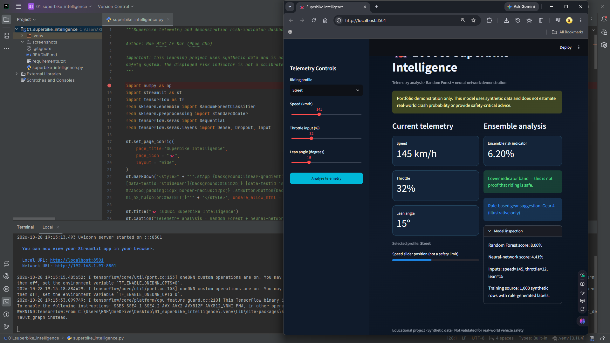

# Superbike Performance & Safety Intelligence System

**Junior Machine Learning Portfolio Project 01/06**  
**Author:** Moe Htet Ar Kar (Phoe Cho)

An interactive telemetry dashboard that combines a Random Forest classifier and a small TensorFlow/Keras neural network to produce a demonstration riding-risk indicator.

> **Scope:** A learning and portfolio application built with a small, understandable Python script. It is not a production or safety-critical system.

## Dashboard Design



## What the project demonstrates

- Building an interactive user interface with Streamlit.
- Preparing input features in a consistent order and passing them to a scikit-learn model.
- Training and caching a model to avoid retraining on every Streamlit rerun.
- Presenting model output and interpreting it with appropriate caveats.
- Organizing a small Python project with isolated dependencies and Git hygiene.

## Model and data

**Model / workflow:** RandomForestClassifier + Keras Sequential neural network; StandardScaler; simple rule-based gear guidance.

**Training data:** 1,000 rows of generated telemetry (speed, throttle, lean angle). Labels are generated from a hand-written threshold rule, then 5% are flipped to introduce label noise.

## Output design

A dark telemetry dashboard with three sidebar controls (speed, throttle, lean angle), a riding-mode selector, an ensemble risk indicator, model-specific scores, threshold-based warning states, gear guidance, and a detailed model inspection panel.

The live application is designed to show the entered features, the model output, and an explanation of what the result means. A prediction is only as reliable as its data, labels, features, and evaluation method.

## Technology stack

- Python 3.11
- Streamlit
- pandas / NumPy where used by this project
- scikit-learn
- TensorFlow/Keras where required by this project

## Run locally

### 1. Prerequisite

Install **64-bit Python 3.11**. Confirm it is available in your terminal:

```bash
python --version
```

On Windows, if the `python` command points to another interpreter, use `py -3.11` in place of `python` when creating the environment.

### 2. Create and activate a virtual environment

**Windows PowerShell**

```powershell
py -3.11 -m venv .venv
.\.venv\Scripts\Activate.ps1
python -m pip install --upgrade pip
```

**macOS / Linux**

```bash
python3.11 -m venv .venv
source .venv/bin/activate
python -m pip install --upgrade pip
```

### 3. Install dependencies

```bash
python -m pip install -r requirements.txt
```

**Environment note:** Use 64-bit Python 3.11. TensorFlow is a relatively large dependency; initial installation and model training can take longer than the other projects. On native Windows, the provided configuration is intended for CPU execution. TensorFlow native-Windows GPU support has limitations; see the official guide linked below.

### 4. Start the application

Run this command from the same folder as `requirements.txt`:

```bash
streamlit run superbike_intelligence.py
```

Streamlit prints a local URL in the terminal (normally `http://localhost:8501`). Open that address in your browser. To stop the app, press `Ctrl+C` in the terminal.

## Project folder structure

```text
01_superbike_intelligence/
├── .venv/
├── superbike_intelligence.py
├── requirements.txt
├── README.md
├── .gitignore
└── screenshots/
    └── output.png       
```

## Current limitations

All training samples are synthetic and labels come from an invented threshold rule. The ensemble score is not a calibrated crash probability and cannot predict real crashes. 
Riding-mode multipliers and gear guidance are demonstration heuristics only. Do not use this project for real-world riding or vehicle safety decisions.

## Future improvements

1. Replace generated or toy data with a documented, appropriate dataset and record its source and license.
2. Add a repeatable evaluation process, appropriate metrics, baseline comparisons, and model-validation tests.
3. Save a trained model only after validating it, then separate training from app inference if the project grows.
4. Add input validation, clear error messages, and a simple automated test suite.
5. Capture real screenshots and document a reproducible test scenario.

## Portfolio summary

This project demonstrates a junior-level end-to-end workflow: a Python ML model, a simple interactive front end, input handling, result presentation, dependency isolation, and honest documentation of limitations.
It should be presented as a learning prototype rather than a production-grade system.

## References

- [Streamlit documentation](https://docs.streamlit.io/)
- [TensorFlow installation guide](https://www.tensorflow.org/install)
- [scikit-learn Random Forest documentation](https://scikit-learn.org/stable/modules/ensemble.html#forests-of-randomized-trees)
